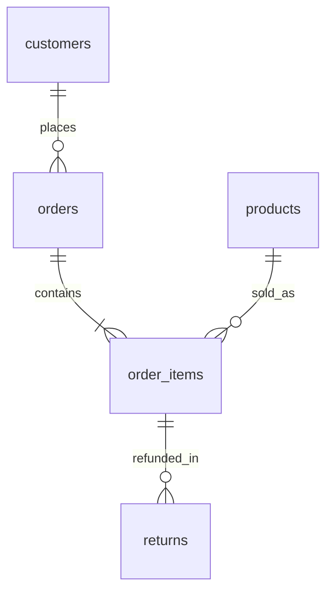

# Model and metric contract

## Table grains

| Table | Grain and key | Important fields |
|---|---|---|
| customers | One generated signup; customer_id | Signup date, channel, region; no personal data |
| products | One catalog product; product_id | Category, current list price and unit cost |
| orders | One order; order_id | Customer, order date, completed/cancelled status |
| order_items | One order line; order_item_id | Product, quantity, historical unit price/cost, line discount |
| returns | One return event; return_id | Order line, date, units, refund and reason |

All monetary fields are exact decimal CAD. `discount_amount` applies to the whole line. Two return events can reference a single line; therefore joining raw returns directly to items duplicates item amounts. The `item_economics` view aggregates returns first. `order_economics` then aggregates lines into one order row. Orders are the canonical grain for order counts and average order value.

## Definitions

| Metric | Definition |
|---|---|
| Gross sales | Quantity × historical unit price on completed order lines |
| Booked sales | Gross sales minus line discounts |
| Refunds | Actual generated refund amounts observed before 2026-02-01 |
| Net sales | Booked sales minus observed refunds; attributed to original sale month |
| Retained COGS | (Sold quantity − returned quantity) × historical unit cost |
| Merchandise margin | Net sales − retained COGS; assumes returns are fully resellable |
| Net AOV | Net sales / completed orders, including orders later fully refunded |
| Unit return rate | Returned units / sold units, not percentage of orders returned |
| Repeat buyer rate | Customers with ≥2 completed orders / customers with ≥1 completed order |
| Cohort | Calendar month of first completed order |
| Month-N retention | Distinct cohort buyers with a completed order in calendar month N / original cohort size |
| Recency | Days from last completed purchase to 2026-01-01 |
| Frequency | Count of completed orders through 2025-12-31 |
| Monetary | Net sales on those orders after observed refunds |

RFM uses five equal-sized customer buckets, with higher scores indicating more recent, frequent and valuable buyers. Ties are deterministically broken by customer ID, so identical values may receive different scores. The customers have different lengths of exposure; RFM is a descriptive shortlist, not an unbiased channel comparison.

## Time and edge cases

- Completed orders are included; cancelled orders and their lines are excluded from every analytic view.
- Date windows use exclusive upper bounds. The seed has no orders after 2025-12-31 and no returns after the 30-day window.
- A zero denominator produces NULL. Growth from a month with zero net sales is undefined.
- Missing mature cohort activity is reported as zero. Months beyond 2025-12 are absent, not zero.
- All financial views are final-window restatements, not point-in-time historical ledger snapshots. Building an as-of ledger would require event accounting.
- The quality suite verifies cross-row return limits and chronology; those are not fully enforced by row-level CHECK constraints. This is an analytics fixture, not a production order-entry application.
